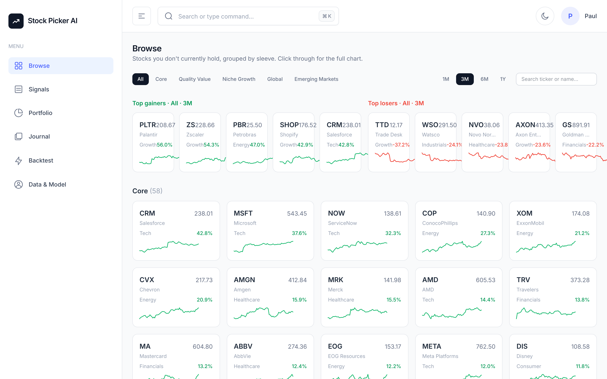

# Momentum + Sentiment Equity Screener

A research and backtesting tool that finds stocks pulling back inside a strong
uptrend, scores them 1 to 10, and builds a monthly portfolio from the best.
It covers 156 global stocks and runs entirely on free data.



> Not investment advice. This is a research tool. The backtest results below
> are survivorship-biased (see [Limitations](#limitations)).

## What it does

- **Screens 156 stocks** across five groups: US large caps (58), quality/value
  (32), niche growth (22), developed ex-US via ADRs (19) and emerging markets
  via ADRs (25, across 11 countries).
- **Scores each one 1 to 10** (the "AI Score") and labels it BUY, HOLD or AVOID.
- **Picks a portfolio** of up to 15 names, sized by inverse volatility, with
  caps on any one sector (40%) or non-US country (20%).
- **Backtests the strategy** from 2016 with daily mark-to-market.
- **Tracks news sentiment** from RSS feeds, Yahoo Finance news and Alpha Vantage.

## Results (2016 to 2026, monthly rebalance)

| | CAGR | Sharpe | Max drawdown | Trades | Win rate |
| --- | --- | --- | --- | --- | --- |
| Strategy | 25.5% | 1.27 | -23.4% | 1,195 | 59.6% |
| SPY (buy and hold) | 14.9% | | | | |

Momentum only; the sentiment overlay is off in the backtest (see
[why](#why-sentiment-is-off-in-the-backtest)).

## How a stock gets picked

A stock qualifies only when it is **a winner having a healthy dip**:

| Check | Rule | Why |
| --- | --- | --- |
| Trend | 12-month return above 5%, price above its long moving average | Only buy established winners |
| Leadership | Within 25% of its 52-week high | Strong, but not bought at the peak |
| Pullback | RSI between 30 and 50 | A dip, not a crash |
| Sentiment | News score not negative | Skip names with bad news |

When more stocks qualify than there are slots, they are ranked by momentum
first, with a smaller weight on 52-week-high proximity.

### The AI Score (1 to 10)

A blend of three layers, each normalised across the universe:

| Layer | Weight | Inputs |
| --- | --- | --- |
| Technical | 45% | 12-month momentum, RSI pullback, 52-week-high proximity, volatility, MACD |
| Fundamentals | 30% | ROE, forward P/E, EV/EBITDA, debt-to-equity, margins |
| Sentiment | 25% | News sentiment (VADER and Alpha Vantage) |

If a layer has no data for a stock, its weight is shared out across the
layers that do, and a confidence percentage shows how much of the score was
backed by real data.

## Running it

You need Python 3.10+ and, for the web app, Node.js 18+.

```bash
git clone https://github.com/Boakye-20/momentum_sentiment_free.git
cd momentum_sentiment_free
pip install -r requirements.txt
cp .env.example .env
```

**Quick check, no internet needed:**

```bash
python tests/test_smoke.py              # whole pipeline on synthetic prices
python main.py backtest --synthetic     # backtest + report, offline
```

**Research dashboard (Streamlit):**

```bash
python -m streamlit run dashboard.py
```

**Web app (Next.js + FastAPI):**

Set `API_SECRET_KEY` in `.env`, and put the same value in `frontend/.env.local`.
Generate one with `python -c "import secrets;print(secrets.token_hex(32))"`.

```bash
pip install fastapi uvicorn
uvicorn api.server:app --port 8000            # terminal 1
cd frontend && npm install && npm run dev     # terminal 2
```

Open http://localhost:3000.

### Web app pages

| Page | What it shows |
| --- | --- |
| Browse | The screener: top picks, filterable and sortable table of every stock |
| Signals | The current portfolio the strategy would hold |
| Portfolio | Your Trading212 holdings, scored (optional, read-only) |
| Journal | Your filled Trading212 orders, checked against what the strategy picked (optional) |
| Backtest | Equity curve, drawdown and monthly returns |
| Data & Model | Plain-English explanation of how every number is produced |

### Command line

| Command | What it does |
| --- | --- |
| `python main.py backtest` | Historical backtest and report |
| `python main.py signals` | Today's signals |
| `python main.py fetch-sentiment` | Log today's free news sentiment |
| `python main.py fetch-av-sentiment` | Backfill Alpha Vantage sentiment history (25 requests/day) |
| `python main.py execute-trades` | Trading212 orders. Dry run unless you pass `--live` |

## Data sources

All free:

| Source | Used for | Key needed |
| --- | --- | --- |
| Yahoo Finance (`yfinance`) | Prices and fundamentals | No |
| RSS feeds + Yahoo news + VADER | Live news sentiment | No |
| Alpha Vantage NEWS_SENTIMENT | Sentiment history from 2022 | Free key |
| Twelve Data | Backup price source if Yahoo fails | Free key |

Every key in `.env.example` is optional except `API_SECRET_KEY`, which only the
web app needs. The OpenAI key (for the optional AI Copilot chat) is the only
paid service, and nothing else depends on it.

## What we learned

### Rebalancing monthly is most of the strategy

Same rules, only the rebalance frequency changed (2016 to 2026):

| Rebalance | CAGR | Sharpe | Max drawdown | Average hold |
| --- | --- | --- | --- | --- |
| Monthly | +25.6% | 1.28 | -23.4% | 37 days |
| Weekly | +13.6% | 0.76 | -25.7% | 11 days |
| Daily | -0.3% | 0.08 | -41.7% | 4 days |

Momentum needs weeks to pay out. Because the RSI pullback rule makes stocks
flicker on and off the list day to day, reacting daily pays trading costs on
every wobble and sells winners early. The live trading script reads its
rebalance frequency from the same setting as the backtest, so the two can't
drift apart.

### Why sentiment is off in the backtest

Turning the sentiment overlay on made the backtest worse on every measure.
Sentiment history only goes back to 2022, so for 2016 to 2021 it replaced a
working ranking signal with nothing. Only about half the universe has good
coverage so far, so this is a verdict on coverage, not on sentiment.

### Safeguards

- **No look-ahead:** a backtest date only ever sees data available on that date.
- **Daily mark-to-market:** Sharpe and drawdown come from daily returns, not
  monthly snapshots, which would overstate Sharpe.
- **No fake data:** missing sentiment is filled with that day's average, not
  zero. News sentiment leans positive, so zero would quietly read as bad news.

## Limitations

- **Survivorship bias.** The universe is today's stocks, so companies that
  failed or delisted since 2016 are missing. This flatters the backtest, more
  so for emerging markets.
- **One period.** 2016 to 2026 was mostly a bull market, so the strategy has
  not been tested through a long bear market.
- **No currency conversion.** Prices are in US dollars, though labels use £.

## Project layout

```
config.py            Every setting: universe, signal rules, sizing, caps
main.py              Command-line interface
dashboard.py         Streamlit research dashboard
api/server.py        FastAPI backend for the web app (read-only)
frontend/            Next.js web app
src/
  data.py            Prices, with caching and a Twelve Data fallback
  momentum.py        Momentum, 52-week high, RSI, moving averages, volatility
  sentiment.py       Live news sentiment
  av_sentiment.py    Alpha Vantage sentiment history
  fundamentals.py    Fundamental ratios
  scoring.py         The AI Score
  signals.py         Turns scores into portfolio weights
  backtest.py        The backtest engine
  executor.py        Trading212 order placement
scripts/             Daily data fetch, alerts, experiments
tests/               Offline smoke test
```

## Author

Paul Kwarteng ([@Boakye-20](https://github.com/Boakye-20)).
